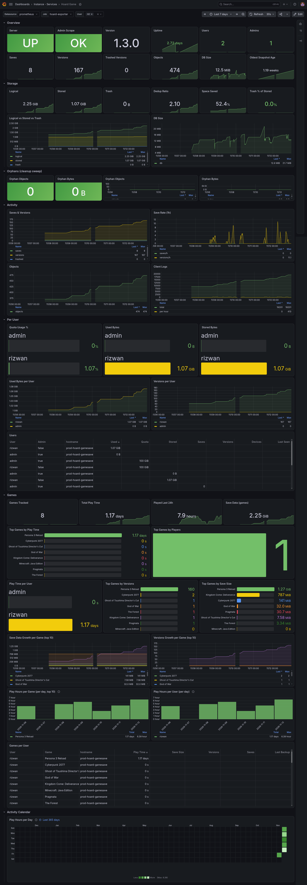

# hoard-exporter

A Prometheus exporter for a self-hosted [Hoard](https://github.com) server. It scrapes Hoard's own JSON endpoints and re-exposes the numbers on `/metrics`, together with a ready-to-use Grafana dashboard covering storage, users, games and **play time**.

- Pure Go standard library, no external dependencies
- Results are cached, so Prometheus scrapes never hit Hoard's database directly
- Degrades gracefully: if one request fails, the exporter logs it and keeps serving the last good data

> **Note:** `/v1/admin/overview` is an internal, undocumented endpoint (reverse-engineered from the hoard-server source). A new Hoard release may change its shape without notice.



## Features

- Server health, version and uptime
- Storage stats: logical vs. stored (deduplicated) bytes, trash, orphan objects, DB size
- Per-user quota, saves, versions, devices and last-seen
- **Per-user, per-game metrics**: play time, saves, versions, bytes, last backup
- Grafana dashboard with play-time panels:
  - **Play Hours per Day** (GitHub-style calendar heatmap)
  - **Play Hours per Game** (per day, top 10)
  - **Play Hours per User** (per day)
  - and the existing storage / quota / health panels

## Requirements

- A running Hoard server and an **admin** device token
- Prometheus or VictoriaMetrics
- Grafana 10+ with the GitHub-style heatmap panel plugin (see [Grafana Setup](#grafana-setup))
- Docker + Docker Compose (or Go, for a manual build)

## Setup

### 1. Create an admin device token

Through the Hoard web dashboard (`Users` -> create a new token under an admin account), or via the shell:

```bash
hoard-admin token create <admin-user> --device exporter
```

### 2. Create a `.env` file

Next to your Compose file:

```env
HOARD_TOKEN=hoard_v1_xxxxxxxx
```

### 3. Add the exporter to your Compose stack

```yaml
services:
  hoard-exporter:
    build: ./hoard-exporter
    container_name: hoard-exporter
    restart: unless-stopped
    environment:
      HOARD_URL: http://server:12421          # adjust to your hoard-server service name
      HOARD_TOKEN: ${HOARD_TOKEN}
      # Per-user game & play time metrics, pick ONE of the two options below:
      HOARD_MINT_USER_TOKENS: "true"          # option A: auto-mint a token per user
      # HOARD_USER_TOKENS: "alice=hoard_v1_aaa,bob=hoard_v1_bbb"   # option B: explicit tokens
    volumes:
      - hoard-exporter-data:/data             # persists minted tokens across restarts
    ports:
      - "9477:9477"

volumes:
  hoard-exporter-data:
```

Adjust the service name, network and ports to match your existing Hoard stack.

### 4. Start the exporter

```bash
docker compose up -d --build hoard-exporter
```

Check that it works:

```bash
curl http://localhost:9477/metrics | grep hoard_user_game_playtime_seconds
```

### 5. Add a scrape job

In your Prometheus / VictoriaMetrics config:

```yaml
- job_name: hoard
  static_configs:
    - targets: ["hoard-exporter:9477"]   # or IP:9477 if running on a different host
```

## Per-user data: how the play time metrics work

`/v1/admin/overview` only returns account-level totals. Games and play time are only available through each user's **own** endpoints (`/v1/me/overview` and `/v1/playtime`), which are scoped to the bearer token. So to get per-game and play-time metrics, the exporter needs a token for every user. There are two ways to provide one:

| Method | How it works |
|--------|--------------|
| **Explicit tokens** (`HOARD_USER_TOKENS`) | You supply `username=token` pairs. Nothing is created on the server. |
| **Auto-mint** (`HOARD_MINT_USER_TOKENS=true`) | The exporter uses the admin token to create a device named `hoard-exporter` for each user via `POST /v1/admin/tokens`, and saves the tokens in `HOARD_STATE_FILE`. If a minted token is later revoked (401/403), it is dropped and a fresh one is minted on the next poll. |

An explicit entry in `HOARD_USER_TOKENS` always wins over auto-mint for that user. Users with no token available are skipped silently (no metrics emitted for them).

If **neither** option is configured, the exporter still works, but only the server-level and per-user storage metrics are exposed; all `hoard_user_game_*` and `hoard_user_playtime_seconds` metrics are absent, and the play-time panels will be empty.

> **Security:** minted tokens are stored in plain text in the state file (permissions `0600`). Keep the `/data` volume private.

## Configuration (Environment Variables)

| Variable                 | Required | Default                              | Description |
|--------------------------|----------|--------------------------------------|-------------|
| `HOARD_URL`              | Yes      | -                                    | Base URL of hoard-server, e.g. `http://server:12421` |
| `HOARD_TOKEN`            | Yes      | -                                    | Admin device token (`hoard_v1_...`) |
| `LISTEN_ADDR`            | No       | `:9477`                              | Address the exporter listens on |
| `SCRAPE_INTERVAL`        | No       | `15s`                                | Polling interval for hoard-server (not the Prometheus scrape interval; the exporter caches results to avoid hitting the database on every Prometheus scrape) |
| `HOARD_TIMEOUT`          | No       | `10s`                                | Timeout for each request to hoard-server |
| `HOARD_USER_TOKENS`      | No       | -                                    | Comma-separated `username=token` pairs, e.g. `alice=hoard_v1_aaa,bob=hoard_v1_bbb` |
| `HOARD_MINT_USER_TOKENS` | No       | `false`                              | Set to `true` to auto-mint a device token for every user through the admin API |
| `HOARD_STATE_FILE`       | No       | `/data/hoard-exporter-tokens.json`   | Where minted tokens are persisted. Mount `/data` as a volume, otherwise a new token per user is minted on every container recreate |

## Exposed Metrics

### Exporter / server health

From `/v1/health` (always available, public, stable):

- `hoard_up` — 1/0
- `hoard_build_info{version}` — always 1, with the version as a label
- `hoard_uptime_seconds`
- `hoard_last_scrape_timestamp_seconds` — time of the most recent scrape attempt, successful or not

### Server totals

From `/v1/admin/overview` (requires an admin token, **internal/unstable**):

- `hoard_scrape_success` — 1/0, indicates whether the metrics below are valid
- `hoard_users_total`, `hoard_admins_total`
- `hoard_saves_total`, `hoard_versions_total`, `hoard_versions_trashed_total`
- `hoard_logical_bytes`, `hoard_stored_bytes`, `hoard_trash_bytes`
- `hoard_orphan_objects_total`, `hoard_orphan_bytes` — **worth alerting on**: if these keep increasing, the hoard-server cleanup sweep may not be working properly
- `hoard_objects_total`, `hoard_client_logs_total`
- `hoard_db_bytes` — SQLite file + WAL size (omitted on non-SQLite backends)
- `hoard_oldest_snapshot_timestamp_seconds`

### Per user

Labels: `{username, is_admin}`

- `hoard_user_used_bytes`
- `hoard_user_quota_bytes`
- `hoard_user_stored_bytes`
- `hoard_user_saves_total`
- `hoard_user_versions_total`
- `hoard_user_devices_total`
- `hoard_user_last_seen_timestamp_seconds`

### Per user: games and play time

Requires per-user tokens (see [above](#per-user-data-how-the-play-time-metrics-work)). Source: `/v1/me/overview` and `/v1/playtime`.

Labels: `{username}`

- `hoard_user_game_scrape_success` — 1 if this user's data was read on the last scrape
- `hoard_user_playtime_seconds` — all-time play time, **including** time not attributed to any game
- `hoard_user_games_total` — games with a save or play time

Labels: `{username, game, game_name}`

- `hoard_user_game_playtime_seconds` — all-time play time in this game
- `hoard_user_game_saves`
- `hoard_user_game_versions`
- `hoard_user_game_bytes` — logical (pre-dedup) bytes
- `hoard_user_game_last_backup_timestamp_seconds`

Missing timestamps (`null` in JSON, e.g. users who never logged in, games never backed up) are exported as `-1` instead of `0`, so they cannot be confused with a real Unix epoch timestamp (January 1, 1970).

All play-time metrics are **all-time totals**. Daily/hourly figures in Grafana are derived with PromQL (`increase`, `delta`), and rankings such as top 10 are done with `topk`. The exporter does not compute them.

## Grafana Setup

### 1. Install the required plugin

The **Play Hours per Day** panel uses a GitHub-style calendar heatmap plugin that is not bundled with Grafana.

Plugin ID: `<PLUGIN_ID>`

**Docker Compose** (recommended): add it to your Grafana service and recreate the container:

```yaml
services:
  grafana:
    image: grafana/grafana:latest
    environment:
      # Grafana 12+
      GF_PLUGINS_PREINSTALL: <PLUGIN_ID>
      # Older versions: GF_INSTALL_PLUGINS: <PLUGIN_ID>
    volumes:
      - grafana-data:/var/lib/grafana
```

```bash
docker compose up -d --force-recreate grafana
```

**Existing install / CLI:**

```bash
grafana-cli plugins install <PLUGIN_ID>
sudo systemctl restart grafana-server
```

If the plugin is unsigned, also allow it explicitly:

```yaml
GF_PLUGINS_ALLOW_LOADING_UNSIGNED_PLUGINS: <PLUGIN_ID>
```

Verify under **Administration -> Plugins and data -> Plugins** that it shows up as installed.

### 2. Add the data source

Add Prometheus (or VictoriaMetrics, using the Prometheus data source type) pointing at wherever the `hoard` job is scraped.

### 3. Import the dashboard

1. **Dashboards -> New -> Import**
2. Upload `grafana/hoard-dashboard.json`
3. Pick your Prometheus data source and click **Import**

### Play-time panels

| Panel | Visualization | Idea |
|-------|---------------|------|
| **Play Hours per Day** | GitHub-style heatmap (plugin) | Total hours played per calendar day across all users |
| **Play Hours per Game** | Stacked bars / time series | Hours per day for the top 10 games |
| **Play Hours per User** | Stacked bars / time series | Hours per day for each user |

Example PromQL (the dashboard's actual queries may differ slightly):

```promql
# Play Hours per Day (all users)
sum(increase(hoard_user_playtime_seconds[1d])) / 3600

# Play Hours per Game (per day, top 10)
topk(10, sum by (game_name) (increase(hoard_user_game_playtime_seconds[1d]))) / 3600

# Play Hours per User (per day)
sum by (username) (increase(hoard_user_playtime_seconds[1d])) / 3600
```

Tips:

- Set the panel **Min interval / Step** to `1d` so each point is one day.
- Because `hoard_user_playtime_seconds` includes time not attributed to a game, the per-user total can be higher than the sum of per-game values.
- Play-time history starts from the moment the exporter first scraped it. Older days will be empty, and the heatmap needs enough Prometheus **retention** to cover the range you display (e.g. 1 year of heatmap = at least 1 year of retention).
- Newly added games or users can show an inflated first day: the first sample is the full all-time total, not a delta.

## Example PromQL Alerts

```promql
# Server down
up{job="hoard"} == 0 or hoard_up == 0

# Exporter can reach Hoard but the admin endpoint fails
hoard_up == 1 and hoard_scrape_success == 0

# Per-user play-time scrape failing (bad / revoked token)
hoard_user_game_scrape_success == 0

# Possible cleanup sweep failure
increase(hoard_orphan_objects_total[1h]) > 0 and hoard_orphan_objects_total > 100

# User approaching quota
hoard_user_quota_bytes > 0
  and (hoard_user_used_bytes / hoard_user_quota_bytes) > 0.9
```

## Troubleshooting

| Symptom | Likely cause |
|---------|--------------|
| `hoard_scrape_success 0` | Token is not an admin token, or the server is too old / has changed `/v1/admin/overview`. Check the exporter logs. |
| No `hoard_user_game_*` metrics at all | Neither `HOARD_USER_TOKENS` nor `HOARD_MINT_USER_TOKENS=true` is set. |
| `hoard_user_game_scrape_success 0` for one user | That user's token is invalid or revoked. Minted tokens are replaced automatically; explicit tokens must be fixed manually. |
| A new token is minted for every user after each restart | `/data` is not a persistent volume, so `HOARD_STATE_FILE` is lost. |
| Heatmap panel shows "plugin not found" | The plugin is not installed, Grafana was not restarted, or the plugin is unsigned and not allowed. |
| Play-time panels show "No data" | Time range is longer than data/retention, step is not `1d`, or per-user tokens are not configured. |

## Development / Manual Build

```bash
go build -o hoard-exporter .
HOARD_URL=http://IP:12421 HOARD_TOKEN=hoard_v1_... ./hoard-exporter
```

With per-user play-time metrics:

```bash
HOARD_URL=http://IP:12421 \
HOARD_TOKEN=hoard_v1_... \
HOARD_MINT_USER_TOKENS=true \
HOARD_STATE_FILE=./hoard-exporter-tokens.json \
./hoard-exporter
```

There are no external dependencies (pure Go standard library), so a simple `go build` is all you need. No `go mod tidy` or internet access to download packages is required.

Endpoints: `/metrics` (Prometheus), `/healthz` (the exporter's own liveness, not hoard-server's).